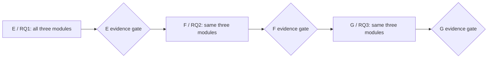

# HMBC E → F → G implementation plan

**Live phase (2026-10-12):** E retains its qualified recorded PASS. The human
authorized branch convergence so all three agents can start F0 from identical
tracked files (D51/A3-0052). First freeze the component/key-control fault matrix
and exact source/interface plan with affected ACKs. No F result is claimed; G
remains locked. See communication/F0_BASELINE.json and the current BOARD.md.

> **For agentic workers:** implement the tasks in your assigned module with the executing-plans workflow. The user selected three persistent concurrent agents. Do not spawn replacement agents, split ownership by E/F/G, or create worktrees. Steps use checkboxes; unchecked means not done.

**Goal:** answer three HMBC research questions one at a time with an executable reconstruction, independently tested repairs, stated fault/cryptographic assumptions and reproducible evidence.

**Architecture:** agent 1 owns the ledger and policy state; agent 2 owns clients, relay/witnesses and key services; agent 3 owns independent models, scenarios, integration and reports. All three modules participate in every phase and integrate through versioned artifacts.

**Tech stack:** Solidity/Forge/Anvil, Python, ProVerif, TLC; an inspected reference ABE adapter for G. Exact versions are a setup deliverable. Source ledger safety is a core F assumption; Besu is an optional extra experiment.

**Spec:** [SPEC.md](SPEC.md). **Interface:** [interfaces/README.md](interfaces/README.md). **Live state:** [communication/BOARD.md](communication/BOARD.md).

## 1. Global constraints

- Work directly in `/home/karma/Documents/RIS`.
- HMBC2020 only. JANUS remains archived.
- Finish and freeze E/RQ1 before F/RQ2; finish and freeze F/RQ2 before G/RQ3.
- Preserve strict/minimal source completions and tag all chosen details. A constructed attack does not establish an original-paper implementation defect.
- Use one PBC and one populated Hospital DBC, four synthetic hospitals H1–H4, and one witness in E / four with q=3 in F/G.
- Source/destination ledgers and the key worker remain explicit trust boundaries; ordinary EVM storage is not secret storage.
- A real ABE compatibility gate is mandatory before G makes implemented cryptographic claims.
- All agents contribute to the same active RQ; code ownership stays fixed across phases.
- Separate checkouts: only the owner edits a module. Only agent 3 changes root integration files, shared interfaces, lockfiles and the board, or runs shared services.
- No dates or eight-week completion commitment are inferred. Close evidence gates, not calendar boxes.

## 2. Why this order and what “complete” means

**E first:** it yields a small runnable access-flow experiment, source-grounded classifications, a repair and an RQ report. It establishes the identifiers and services needed by both later phases.

**F second:** add malicious operators, witnesses and governance to a working E flow. Reuse the same request/certificate/event interfaces. Evaluate threshold safety and residual trusted components without starting a new chain implementation.

**G third:** reuse the tested authorization/quorum path for key lifecycle. This has the most uncertainty because the actual ABE policy, partial-decryption composition, ciphertext updates and retained secrets determine the answer.

An RQ is complete when its report answers the question under stated assumptions, the required tests/models and negative controls have run, a fresh integrated run is reproducible, limitations are explicit, and all three agents acknowledge the same gate evidence. A finding may be refuted. A required component that never ran is BLOCKED, not a negative research result. G cannot close with only a toy cryptographic adapter.

## 3. Modules that stay fixed across all three RQs

| Module / agent | E: access flow | F: Byzantine operators | G: key lifecycle |
|---|---|---|---|
| **1 — ledger** | Six minimal HMBC roles, issuer checks, nonce/epoch state, grant/audit records | Threshold verification, action-bound governance, monotone state and fault-resistant transitions | Epoch commitments, prepare/commit/retire state, stale-epoch rejection and record commitments |
| **2 — protocol** | User signing, relay, honest witness, durable key-worker simulation | Four witness workers, quorum collection, fault injection and persistent anti-equivocation | Actual ABE/AEAD adapter, epoch key/wrapper lifecycle, retained-key/compromise fixtures |
| **3 — evaluation** | Source map, independent oracles, ProVerif, integration and RQ1 report | Fault schedules, TLC, trust/threshold matrix and RQ2 report | Secrecy games, lifecycle model, real-decryption matrix, overhead and RQ3 report |

Modules are independently testable against shared fixtures. Integration happens after each vertical slice, not only after all coding. Reports and frozen run manifests preserve the result at each gate.

## 4. E0 — common foundation, before parallel feature implementation

**Owners:** all three, coordinated by agent 3. Dependency: none. This is the current starting task.

**Files to create:** `evaluation/evidence/source-map.csv`, `evaluation/evidence/assumptions.csv`, `interfaces/v1/*.schema.json`, `interfaces/vectors/*.json`, `evaluation/toolchain.json`, root `pyproject.toml`/dependency lock, `ledger/foundry.toml`/ledger locks, and each module's minimal smoke test. Follow ownership: agent 1 creates ledger files, agent 2 identifies protocol dependency needs, agent 3 writes shared files.

- [ ] Each agent reads the HMBC passages listed in `references/README.md`; agent 3 records page/section and exact supported scope for the six roles, GID possession, trust lists, logging, isolation and temporal decryption. Agent 1 checks contract-actuator rows; agent 2 checks the transaction/key flow.
- [ ] Agent 3 defines strict/minimal fixtures for E01/E02/E03. Agent 1/2 acknowledge which choices are inferred and which are explicit extensions. Do not inherit the JANUS U1–U15 catalogue.
- [ ] Freeze interface v1: signers, typed messages, credential-bundle encoding, checkpoint/revocation boundary, grant/cache semantics and errors. Include a positive vector plus one bit/field mutation for each signed field. Agents 1/2 must reproduce identical digest and signer recovery.
- [ ] Agent 3 runs compatibility preflight and records exact versions and lockfiles; agent 1 smoke-tests Forge; agent 2 smoke-tests Python signing; agent 3 smoke-tests the selected ProVerif executable. Isolate any incompatible ABE tooling until G. Do not install a full Kubernetes/Fabric stack.
- [ ] Each module runs one isolated test against the frozen fixture. Agent 3 publishes `INTERFACE_READY` with file hashes; agents 1/2 publish acknowledgements.

**Acceptance:** matching Solidity/Python digests, valid/invalid schema vectors, precise actuator/issuer mapping, a recorded toolchain and three ACKs. No E feature integration on an unversioned interface. E0 may finish while G's adapter is unresolved.

## 5. RQ1 / E — complete the authorization and audit study

### E1 — three modules build the same legitimate flow in parallel

#### A-E1 — agent 1: minimal HMBC ledger

**Create:** `ledger/src/{RSC,TMSC,PSC,LSC,ACSC,KSSC}.sol`, `ledger/src/types/ProtocolTypes.sol`, `ledger/script/Deploy.s.sol`, `ledger/test/AccessFlow.t.sol`, `ledger/test/TrustAnchors.t.sol`, `ledger/exports/` manifests/ABI.

**Consumes:** v1 request/decision/checkpoint vectors. **Produces:** the contract methods and grant/deployment exports in `interfaces/README.md`.

- [ ] Write failing tests: registered Alice with valid credentials reaches an authorized grant; Bob is denied; a registration without GID possession fails; an H1 administrator cannot replace H2's trust anchor. Assert grant/nonce state is unchanged after rejection.
- [ ] Run `forge test --root ledger --match-contract 'AccessFlow|TrustAnchors' -vv`; record the expected failures before implementation.
- [ ] Implement the six roles and strict caller/issuer restrictions with minimal state. Preserve the request log ordering specified in HMBC. Add a configuration for hash-only versus complete synthetic log details.
- [ ] Run the tests to PASS. Export an actual deployment manifest and ABI with source/compiler hashes; do not hand-edit an ABI to satisfy the service.

**Ready:** Alice's positive trace and Bob's denial agree with the frozen fixture; all six roles have documented responsibilities, including omitted functions.

#### B-E1 — agent 2: legitimate client, relay and key-worker adapter

**Create:** `protocol/client.py`, `protocol/relay.py`, `protocol/witness.py`, `protocol/key_worker.py`, `protocol/adapter.py`, `protocol/state.py`, `protocol/tests/test_access_flow.py`, `protocol/exports/adapter.json`.

**Consumes:** ledger manifest and v1 fixtures. **Produces:** `prepare_request`, `collect_decision`, `release` and the JSON-lines adapter boundary. The key adapter is visibly `symbolic` in E.

- [ ] Write failing tests: signature matches the frozen vector; a relay cannot change the signed data/recipient; the honest witness recomputes rather than blindly signs; a worker requires a committed grant.
- [ ] Run `python -m pytest protocol/tests/test_access_flow.py -q` and save the failures.
- [ ] Implement the flow against a fixture ledger adapter, then the real ABI. Persist release intent and cached response before transmission. Keep secrets outside EVM state and result logs.
- [ ] Pass the tests; publish sample input/output and a supported-operation manifest. Reject every unimplemented G operation explicitly.

**Ready:** a legitimate request can obtain a modeled authorized response; recipient binding is enforced; no claim of ABE encryption or production secrecy is made.

#### C-E1 — agent 3: independent oracle and integration skeleton

**Create:** `evaluation/scenarios/e_positive.json`, `evaluation/oracles/access.py`, `evaluation/tests/test_access_oracle.py`, `evaluation/run.py`, `evaluation/gate.py`, `evaluation/manifests.py`.

**Consumes:** both module manifests, v1 schemas. **Produces:** run/scenario results, process lifecycle and comparison between expected and observed events.

- [ ] Write oracle fixtures for Alice allowed, Bob denied and wrong-issuer update rejected; oracle tests must fail for a fake implementation that grants everything or denies everything.
- [ ] Run `python -m pytest evaluation/tests/test_access_oracle.py -q` to prove both negative controls are detected.
- [ ] Implement the runner with owned service processes, isolated output directory and source/tool/input hashes. Run providers through public ABIs/adapters only.
- [ ] Integrate A-E1/B-E1 on two Anvil instances. Record a real event trace and errors; verify valid access works in both strict and repaired profiles.

**Ready:** `python -m evaluation.run --rq E --profile paper-strict --output evaluation/runs/e1` returns a complete manifest, with observed events from actual contracts/services. A stub run is insufficient.

### E2 — test the three case families and implement bounded repairs

Tasks below start after E1 integration. Agents work concurrently on their own files, using the same case IDs.

#### A-E2 — agent 1: binding, freshness and audit state

**Create/modify:** `ledger/src/DecisionVerifier.sol`, relevant six-role contracts, `ledger/test/{DecisionBinding,Freshness,Audit}.t.sol`.

- [ ] Write tests for E01 field substitutions/replay/expiry; E02 old-but-valid signed list replay, wrong issuer and expired on-duty; E03 duplicate outcome and grant-without-request-log. Include boundary time equality and reverted-call state checks.
- [ ] Record which strict/minimal profile fails which assertion before the repair. A strict profile passing is a result to preserve.
- [ ] Implement `repaired-e`: one explicitly trusted witness, typed signed decisions, `(gid, nonce)` consumption, increasing trust/state versions, destination checks and request/grant-correlated events.
- [ ] Pass all legitimate controls and repaired cases. A weaker mutant with destination binding removed must fail the relevant test.

**Verify:** `forge test --root ledger -vv`. **Output:** case-to-property results and revised ABI only through an approved interface RFC.

#### B-E2 — agent 2: adversarial relay and durable recovery

**Create/modify:** `protocol/faults.py`, `protocol/state.py`, service code and `protocol/tests/{test_replay,test_freshness,test_recovery}.py`.

- [ ] Write tests for forged/reordered/duplicated relay messages; delayed checkpoint after PBC revocation; crash before intent, after durable intent, and after send before outcome acknowledgement.
- [ ] Implement named deterministic faults without disabling unrelated caller checks. Keep paper-minimal profile behavior separate from deliberate mutants.
- [ ] Implement recovery, expiry and idempotent cached-response behavior. Classify uncertain delivery after crash rather than inventing a successful delivery record.
- [ ] Verify no new grant after the DBC revocation checkpoint; record any pre-barrier stale-state window. A previously consumed, unexpired grant follows the specified completion rule.

**Verify:** `python -m pytest protocol/tests -q`. **Output:** fault schedules, response/state evidence and all remaining trust assumptions.

#### C-E2 — agent 3: source-grounded classification and formal correspondence

**Create:** `evaluation/scenarios/e_{provenance,freshness,audit}.json`, `evaluation/models/e/access.pv`, `evaluation/models/e/access_mutant.pv`, model README, `evaluation/reports/RQ1-E.md`.

- [ ] Encode the three families' oracles independently of implementation control flow. Check a valid grant exists so the model/test cannot pass by denying all work.
- [ ] Model user request, witness decision and grant correspondence in ProVerif with explicit honest-key assumptions. Query agreement on request identity/subject/data/destination. Keep mutable-state/nonce durability conclusions in state/integration tests unless the formal model actually captures them.
- [ ] Run `proverif evaluation/models/e/access.pv` and its weakened-binding mutant. Save full outputs and state exactly which queries pass, fail or are inconclusive.
- [ ] Run all strict/minimal/repaired scenarios using real modules. Produce source-backed classifications and before/after measurements; do not translate specification ambiguity into a confirmed exploit.
- [ ] Draft RQ1's answer, including refuted cases, trusted witness/worker limitations, non-atomic delivery logging and the explicitly measured revocation window.

**Verify:** evaluator tests, complete E integration matrix and ProVerif outputs. The repaired suite must detect at least one deliberate mutation and preserve all legitimate controls.

### E3 — freeze and close RQ1

- [ ] Agents 1/2 publish READY handoffs including test commands, exit codes, source hashes and remaining caveats.
- [ ] Agent 3 requests an integration freeze; agents 1/2 stop edits and ACK exact file manifests.
- [ ] Agent 3 runs the E gate from a fresh process/data state, checks zero unexpected failures and includes failed/time-out trials in results.
- [ ] All three review `evaluation/reports/RQ1-E.md`; agent 1 checks ledger claims, agent 2 checks protocol/key assumptions, agent 3 checks evidence/model interpretation.
- [ ] Record gate E evidence and ACKs in `communication/GATES.md`. Agent 3 advances the board to F0 only after every mandatory E criterion passes.

**RQ1 deliverable:** one command, fixed inputs, source/profile distinctions, three evaluated case families, verified repairs where applicable, formal query outputs and a standalone answer. This is the first completed research result.

## 6. RQ2 / F — extend the completed system to Byzantine operators

### F0 — freeze the fault model together

**Create:** `evaluation/evidence/fault-model.csv`, `evaluation/scenarios/f_matrix.json`; update interface version only if required.

- [ ] Agent 1 enumerates which contract/ledger states a faulty organization can change; agent 2 enumerates witness, authority, relay and worker keys it controls; agent 3 records independent vs correlated compromise.
- [ ] Fix n=4, q=3, f=1 for application witnesses. List safe-ledger/trusted-worker assumptions, eventual-delivery conditions and the out-of-bound cases.
- [ ] Reserve 0/1/2 faulty-witness schedules, duplicate-signer, stale-view and worker-compromise scenarios. All agents ACK the expected safety/availability classifications before results are run.

### A-F1 — agent 1: certificate and governance rules

**Create:** `ledger/src/QuorumVerifier.sol`, `ledger/src/Governance.sol`, `ledger/test/{Quorum,Governance}.t.sol`; extend TMSC/KSSC through stable entry points.

- [ ] Write failing tests: 3 distinct valid witnesses authorize; 2 fail; a repeated signer counts once/rejects; an unknown signer or old set version fails; signatures for authority addition cannot authorize removal or log access.
- [ ] Implement action/payload/nonce/expiry-bound governance certificates and old-set authorization. Keep the four witness identities fixed in core F; credential membership changes do not rewrite consensus membership.
- [ ] Test one witness withholding, epoch/sequence replay and failed-governance state rollback. Do not weaken the completed E suite.
- [ ] Export signed-case fixtures and contract gas/size measurements through the existing manifest interface.

**Verify:** `forge test --root ledger -vv`; all E cases plus F threshold/governance cases pass.

### B-F1 — agent 2: four independent witness workers

**Create:** `protocol/witness_pool.py`, `protocol/witness_state.py`, `protocol/faults/byzantine.py`, `protocol/tests/test_byzantine.py` (rename the earlier single-file faults module through an owned internal refactor if necessary).

- [ ] Write tests: one equivocating witness cannot make two q=3 conflicting certificates; one refusing witness leaves 3 honest signers; two unavailable witnesses cause a classified timeout; duplicate responses never inflate quorum.
- [ ] Implement separate key/state directories and independently checked decisions. Persist each witness's first signed decision before emitting the signature.
- [ ] Add stale source views, delayed messages, signer restart and divergent proposals. Enforce checkpoint age and state-sequence checks rather than selecting the first replies blindly.
- [ ] Include a compromised-worker scenario demonstrating that a valid certificate layer alone cannot protect secrets held by that worker. Keep this distinct from witness-only resilience.

**Verify:** `python -m pytest protocol/tests/test_byzantine.py -q`, then all protocol tests. Publish fault schedules and evidence of independent verification.

### C-F1 — agent 3: quorum reasoning, finite model and measurements

**Create:** `evaluation/models/f/DecisionQuorum.tla`, `.cfg`, model README, `evaluation/oracles/faults.py`, `evaluation/reports/RQ2-F.md`.

- [ ] Model four witnesses, at most one Byzantine, two conflicting values, persistent honest single-signing and q=3 acceptance. Check agreement. Show why two q=3 sets overlap in at least two signers, including an honest signer when f=1.
- [ ] Run TLC with f=0/1 and meaningful weakened-threshold and f=2 controls. At f=2, allow divergent accepted views explicitly; a false certificate trace is conditional on that modeled source-view failure, not a measured break of safe Anvil consensus.
- [ ] Run integrated availability/safety schedules and preserve timeout results. Distinguish arbitrary-delay nontermination from an eventual-delivery liveness claim.
- [ ] Report the trust matrix, threshold boundary, remaining key-worker/authority risks, certificate/gas/latency overhead, and E regressions.

**Verify:** `java -cp <pinned-tla2tools.jar> tlc2.TLC -config evaluation/models/f/DecisionQuorum.cfg evaluation/models/f/DecisionQuorum.tla` plus F/E integrated gates. Record the actual jar hash/path and explored state counts; never report bounded exploration as a proof of production consensus.

### F2 — close RQ2

- [ ] Repeat READY → freeze → integrated run → three ACKs, using `communication/GATES.md`.
- [ ] RQ2 report must state which components still require trust and which failures are outside f=1. Include valid access under one withholding witness and expected unavailability under two.
- [ ] Retain E's frozen artifact and regression pass. Advance to G0 only after the F gate passes.

**Optional after the core answer:** add a four-validator Besu/QBFT run only if the team wants empirical consensus claims and has measured resources. All three agents share that extra slice: ledger deployment, protocol reconnection/faults, evaluation measurements. It is not required to close the explicitly conditional core RQ2, and it is not HMBC's original PoS.

## 7. RQ3 / G — establish the key lifecycle on the completed E/F system

### G0 — compatibility and security-definition gate, before crypto feature work

**Owners:** all; agent 2 leads the adapter investigation. **Create:** `protocol/crypto/DESIGN.md`, `protocol/crypto/reference_adapter.py`, `protocol/tests/test_reference_crypto.py`, `evaluation/evidence/secrecy-matrix.csv`.

- [ ] Agent 2 reads the source construction and identifies exact scheme/backend, GID binding, authority ownership and two-step decryption equations. Pin the code/parameters; compare ordinary decryption against partial+user completion on the same ciphertext.
- [ ] Agent 1 specifies the proposed epoch/ciphertext commitments and verifies that no secret is needed in contract storage. Agent 3 writes the four secrecy experiments in SPEC before observing outcomes.
- [ ] Run actual positive and negative vectors: correct same-GID key combination decrypts; wrong role/GID/epoch fails; an old cached plaintext stays usable. State exactly which failures are cryptographic and which are online-policy denials.
- [ ] Identify whether the proposed epoch-qualified mediating attribute is compatible with the actual adapter and what old master secrets can regenerate. Record a composition/security argument; a full-decrypt function hidden behind a method called partial is not sufficient.
- [ ] All three ACK the adapter design and actual vector results. If this fails, mark G BLOCKED with a concrete cause; preserve the complete E/F study. Do not substitute symbolic results or invent a novel ABE construction.

### A-G1 — agent 1: epoch and ciphertext commitment state

**Create:** `ledger/src/EpochManager.sol`, `ledger/test/{EpochTransition,CiphertextBinding}.t.sol`; extend KSSC/TMSC state adapters.

- [ ] Write failing tests for `ACTIVE → PREPARING → COMMITTED → RETIRED`, duplicate transitions, skipped/rollback epochs, uncommitted-key release and changed ciphertext metadata under an existing data ID.
- [ ] Implement commitment-only prepare/commit/retire operations, authorized through F's q=3 action-bound certificate. Bind requests/grants to committed key/policy/auth epochs.
- [ ] Test revocation/join concurrent with preparation, replay across restart and partial rollout. Reject stale or uncommitted releases; do not fall back to epoch e to restore availability.
- [ ] Run E/F regressions and export transition events/commitments for integration.

**Verify:** `forge test --root ledger -vv` with all three phases' suites.

### B-G1 — agent 2: real ciphertext and key lifecycle

**Create:** `protocol/crypto/{abe_adapter,records,lifecycle}.py`, `protocol/tests/{test_lifecycle,test_compromise}.py`; implement the frozen G operations of the adapter boundary.

- [ ] Write tests covering fresh e+1 data after revocation, a new member under the no-history policy, a retained old partial output, separate user-key/master-key/worker-key compromises, and ciphertext substitution.
- [ ] Implement fresh record keys, authenticated encryption and the G0-approved ABE wrapper/partial-decryption adapter. Bind data ID, policy, epoch and recipient metadata as frozen in G0. Use fresh cryptographic randomness.
- [ ] Implement durable prepare/commit/recovery and explicit old-key retention vs modeled erasure configurations. Keep current epoch secrets distinct from old master material; document any regeneration path.
- [ ] Return `adapterMode="abe-real"` only for the actual crypto path. Publish measured encryption/partial/final-decryption and key/record sizes, including failures.

**Verify:** `python -m pytest protocol/tests/test_reference_crypto.py protocol/tests/test_lifecycle.py protocol/tests/test_compromise.py -q`, then the full suite.

### C-G1 — agent 3: secrecy matrix and lifecycle analysis

**Create:** `evaluation/scenarios/g_secrecy.json`, `evaluation/models/g/EpochLifecycle.tla`, `.cfg`, `evaluation/models/g/secrecy.pv`, `evaluation/reports/RQ3-G.md`.

- [ ] Model prepare/commit/release/retire with crashes and membership changes; test that uncommitted/stale epochs never authorize new grants. Include a rollback mutant that the model rejects.
- [ ] If ProVerif idealizes ABE as an abstract primitive, state its equations and the unproved implementation correspondence. Query only the chosen key-exposure/epoch events; never infer computational ABE security from a symbolic result.
- [ ] Run the real adapter's decryption matrix independently through the public protocol boundary. Separate denial by the service from inability to decrypt offline with retained material.
- [ ] Measure rotation, wrapper updates, ciphertext/key sizes and per-stage latency. Report unchanged historical ciphertexts and cached-output access as defined limitations/negative controls.
- [ ] Write the exact supported/rejected secrecy claims, authority/worker trust, key-retention assumptions and any backend/model limitation. Compare against the source-mapped static baseline.

**Verify:** TLC/ProVerif commands with saved outputs, G integration using `abe-real`, full E/F regressions and mutation controls.

### G2 — close RQ3 and assemble the project

- [ ] Repeat the common freeze/integration/three-ACK gate. Actual G crypto vectors are mandatory; blocked adapter work is not a pass.
- [ ] Agent 3 assembles `evaluation/reports/STUDY.md` from the three completed RQ reports and a reproduction guide. Agents 1/2 review claims about their modules.
- [ ] Keep one source manifest/configuration and one command for each frozen RQ result. Do not rerun an old report against silently changed assumptions.
- [ ] Recheck every citation used in the final study at passage level. The archived metadata inventory is a lookup aid, not support for novelty or mechanism claims.

## 8. Integration, review and evidence gates

The shared [protocol](communication/PROTOCOL.md) governs each module handoff. Agent 3 is coordinator, not owner of everyone else's code. If A and B finish before C, they review fixtures, negative controls and evidence in their own scope; they do not start the next RQ.

**Review focus, assigned above:** wrong subject/data/destination and duplicate IDs (A-E2/B-E2); stale/reordered trust changes at the revocation barrier (A-E2/B-E2); crash between grant/intent/send/log (B-E2/C-E2); duplicate/equivocating signers and correlated faults (A-F1/B-F1/C-F1); cached secrets, incompatible old policies and partial epoch rollout (G0/A-G1/B-G1/C-G1).

Each task's general cycle is: write independent expected behavior → observe the relevant failure/control → implement the smallest owned change → run the stated tests → publish evidence. For a reconstruction whose strict profile already satisfies a property, record that and use a deliberate mutant to demonstrate oracle sensitivity; do not introduce a bug into the baseline.

No automatic commit is a task acceptance criterion. Agent 3 may prepare a reviewed snapshot; Git commits follow the user's authorization and must avoid unrelated concurrent edits.

## 9. Schedule and scope cuts

Plan in effort intervals after E0 measures the tools and machines: E0 approximately 1–2 focused sessions; E about 4–8 sessions per agent; F about 3–6; G about 5–10, with the largest uncertainty at G0. These are planning estimates, not elapsed-time promises or evidence of feasibility. Formal-tool/backend setup can exceed them.

If time is short, finish E with all three agents first. Then finish the conditional F study. Reduce optional consensus deployment, performance scaling and extra attack families before weakening the evidence gates. If G's primitive compatibility fails, deliver E/F and a documented G blocker/limitation; do not call all three RQs completed.

The next concrete actions are **E0**, then **A-E1 / B-E1 / C-E1 in parallel**. JANUS integration, a new ABE scheme, threshold key sharing, production deployment and DP accounting are outside this plan.
